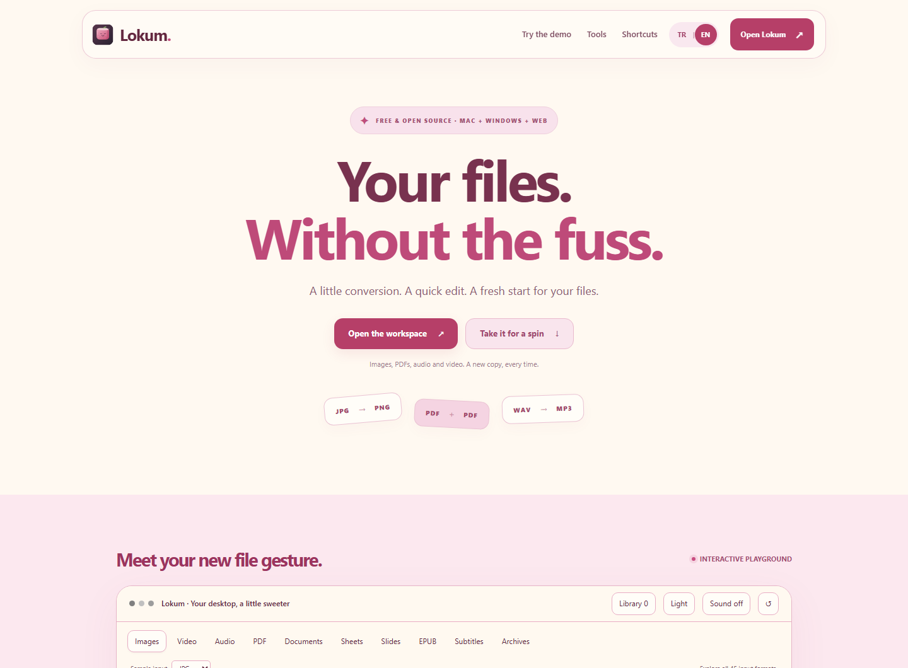
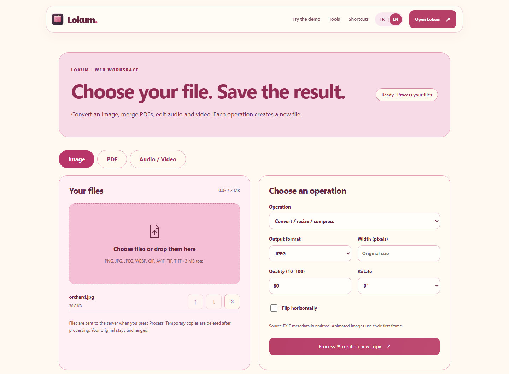
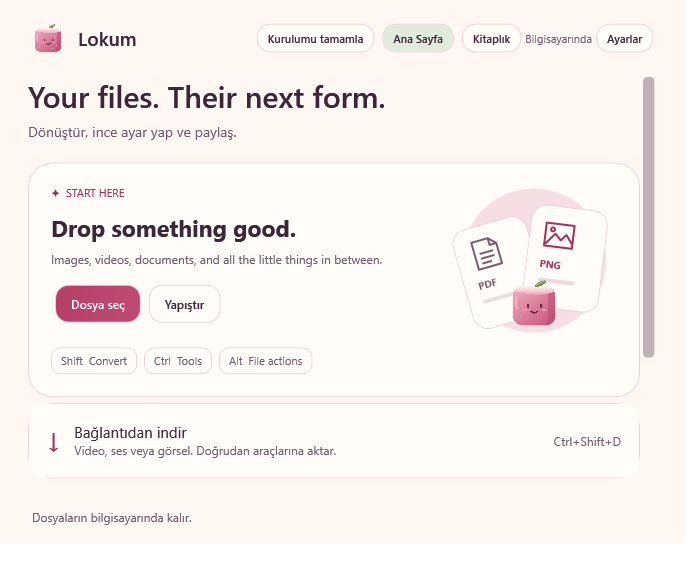
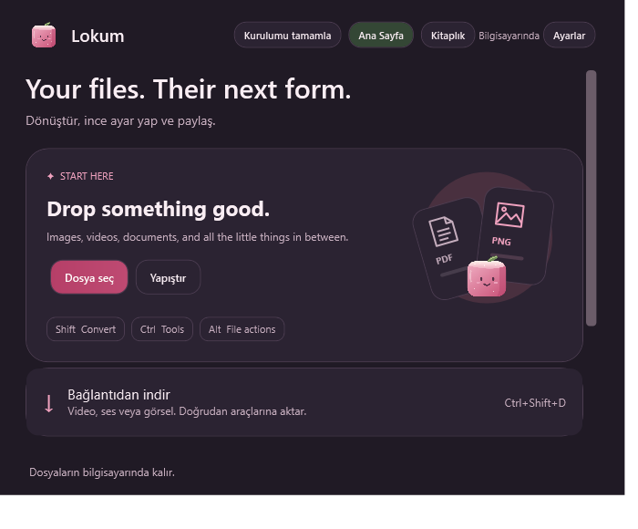
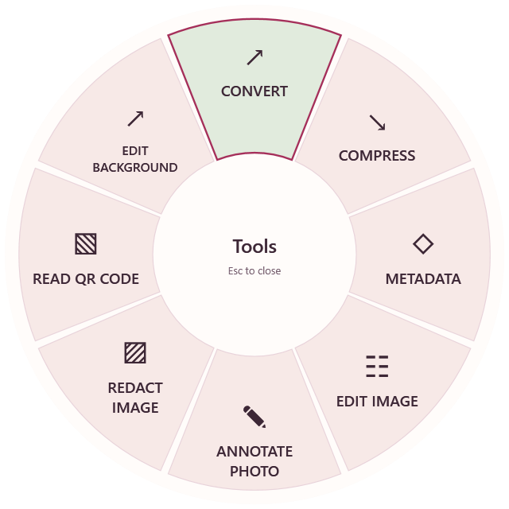
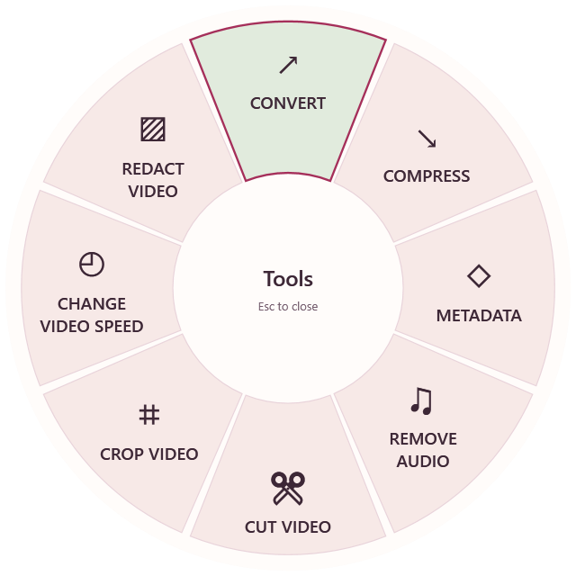

<p align="center"></p>
<h1 align="center">Lokum</h1>
<p align="center">A sweet spot for your files.</p>
<p align="center"><a href="README.md">🇹🇷 TR</a> | <a href="README.en.md"><strong>🇬🇧 EN</strong></a></p>

Lokum is a toolbox for images, video, audio and documents. **The web version is live:** process files in your browser without installing anything, or use the Windows/macOS desktop app for the broader toolset. Choose a file, preview the result and save a fresh copy.

<p align="center"><a href="https://lokum-red.vercel.app/en/app.html"><strong>Open the web app ↗</strong></a> · <a href="https://lokum-red.vercel.app/index.html">Website & interactive demo</a> · <a href="https://lokum-red.vercel.app/app.html">Türkçe web uygulaması</a></p>

[Turkish user guide](README.tr.md) · [Platform matrix](windows/FEATURE-PARITY.md) · [Dependencies](docs/dependencies.md) · [Report a bug / suggest a feature](https://github.com/EnsarAslannn/Lokum/issues)

## Use it on the web

**[lokum-red.vercel.app](https://lokum-red.vercel.app/index.html)** hosts the Turkish/English website, interactive demo and working file workspace. The website and processing API are deployed on Vercel; the API runs on Vercel Functions. No account or installation is required.

| Web workspace | What it does |
| --- | --- |
| Images | PNG/JPEG/WebP/AVIF/TIFF output, resizing, rotation, mirroring and quality settings |
| PDFs | Merge, extract/reorder/rotate pages and create PDFs from images |
| Audio | Convert, trim, change speed and normalize loudness |
| Video | Convert, trim, change width/quality/speed, remove/extract audio and capture a frame |

**Initial limits:** 3 MB total input, up to 8 files, 4 MB output, 24 megapixels per image, 200 PDF pages, a media range of up to 120 seconds and a 60-second processing timeout. Large/long media, Office conversions, automatic subtitles/translation and system actions are available in the desktop app.

The workspace sends files to the server when you press **Process**. Temporary media-processing folders are cleaned up afterward; the result stays in the current browser tab. The interactive website demo processes locally and clearly labels desktop-only tools as previews.

### Web appearance

[](https://lokum-red.vercel.app/index.html)

[](https://lokum-red.vercel.app/en/app.html)

These images show the deployed website in a desktop browser. Both pages include the **TR | EN** language switch.

## Desktop appearance

| Light theme | Dark theme |
| :---: | :---: |
|  |  |

| Image tools | Video tools |
| :---: | :---: |
|  |  |

The wheel adapts to the selected file type.

These are isolated renders of the Windows interface. macOS sources include the theme and icon; a macOS package must be built and verified on a Mac.

## Run Lokum

To use Lokum in your browser, **[open the web workspace](https://lokum-red.vercel.app/en/app.html)**. The steps below are for the desktop application.

The repository contains source code; compiled applications and downloaded tools are excluded from Git. Published packages will be available on the [Releases](https://github.com/EnsarAslannn/Lokum/releases) page. If you already have `Lokum-Windows-x64.zip`, extract the entire folder into a writable location and open **Lokum.exe**. Keep all package files together. The self-contained Windows package does not require a separate .NET installation.

On first launch, use **Finish setup → Download missing tools**. FFmpeg/ffprobe, yt-dlp, Deno, LibreOffice and metadata tools are installed for the features that need them, using pinned versions and SHA-256 verification. Local image and basic PDF operations are available immediately. Canceled or failed downloads can be retried from the same screen.

Windows Library and preferences are stored under `%LOCALAPPDATA%/Lokum`.

## Desktop features

- **45 input formats, 29 shared tools and 275 conversion routes**, with single-file and batch selection.
- **Images:** conversion, compression, resizing, rotation/mirroring, cropping, annotations, frames, collages, metadata, redaction and QR reading.
- **Background editing:** manually select areas to keep or use local automatic selection; export a transparent PNG or replace the background with a palette color or another image. Single images and batches are supported.
- **Video and audio:** conversion, compression, spatial cropping, independent clip ranges, joining, speed changes, normalization and channel controls. Mute an entire video or a selected time range and preview the result. Video redaction shows the selected blur/pixelation style in the processed preview.
- **Automatic subtitles:** choose the original spoken language, create its transcript, and correct misheard words or names. Then choose Turkish or English subtitles. The reviewed transcript is translated locally; preview and edit it before exporting SRT/TXT/VTT or a subtitled MP4. The speech model (148 MB) and one shared translation model (5.7 GB for all supported languages) download once. Translation runs on the CPU and requires more memory and time than the previous small models. No paid API; automatic results still require review.
- **Documents and archives:** create, merge, split and edit PDFs; convert Office files, Pages, EPUBs, tables, presentations and subtitles; work with archives.
- **Everyday tasks:** tool wheels, drag shortcuts, clipboard import, Float shelf, Library, folder automation and window layouts.
- **Web:** download supported public video, audio and image links.

Support depends on the operating system, file structure, installed codecs and external tools. See the [platform matrix](windows/FEATURE-PARITY.md). Complex document conversions may not preserve every source feature. Web downloads depend on the site's behavior.

## Build from source

```sh
git clone https://github.com/EnsarAslannn/Lokum.git
cd Lokum
```

**Windows:** requires the .NET 10 SDK.

```powershell
python scripts/setup-speech-engine.py
python scripts/setup-translation-runtime.py
dotnet restore windows/Lokum.Windows --locked-mode
dotnet publish windows/Lokum.Windows -c Release --no-restore -o build/windows/Lokum
.\build\windows\Lokum\Lokum.exe
```

**macOS:** requires macOS 13.3+, Apple Silicon and Xcode/Swift 6.

```sh
scripts/setup-exiftool.sh
swift build --product Lokum
swift test
scripts/build-app.sh release
```

Outputs are written to `build/windows/Lokum` on Windows and `build/Lokum.app` on macOS. Distribute the entire output folder.

## Development and verification

```powershell
dotnet run --project windows/Lokum.Verify -c Release
python scripts/check-feature-parity.py
python -X utf8 scripts/generate-localizations.py --check
```

Use `Lokum.exe --ui-audit build/ui-audit` after building to render isolated light/dark, Turkish/English scenes. These checks complement physical mouse/keyboard and export tests. See the [UI audit guide](docs/testing/UI-AUDIT.md) and [contribution guidelines](CONTRIBUTING.md).

Build outputs, downloaded tools, local preferences and secrets are excluded through `.gitignore`. Do not commit credentials or personal test files.

## Shortcuts

| Windows | Action |
| --- | --- |
| Ctrl+O / Ctrl+V | Select files / import clipboard content |
| Ctrl+Space | Open the selected files' tool wheel |
| Ctrl + right-click | Local file tools / Download Media on the web |
| Ctrl+1 / Ctrl+2 | Home / Library |
| Ctrl+F | Search Library |
| Ctrl+Shift+D | Open a copied download link |
| Space / ← / → / I / O | Playback, seeking and range marks in supported media editors |
| Shift + drag / Enter | Lock a crop ratio / preview or save the crop according to the editor |

Drag modifiers can be changed in Settings. The macOS defaults are Shift for conversion, Command for tools and Control for file actions. Normal text editing is preserved.

## Privacy and updates

Desktop editing and conversion run locally. Media-link downloads connect to the selected site, and tool setup connects to the relevant distribution source. The web workspace sends files to the server only when you press **Process**. There is no analytics, mandatory cloud account or browser-cookie import.

Signed updates are supported; no automatic update channel is connected until a release repository and trusted signing key are configured. See [release channel configuration](docs/LOKUM.md).

## License

[MIT license](LICENSE). External components retain their own licenses and notices: [Windows](windows/THIRD-PARTY-NOTICES.txt) · [macOS](Resources/THIRD-PARTY-NOTICES.txt).

**Maintainer:** [EnsarAslannn](https://github.com/EnsarAslannn).
