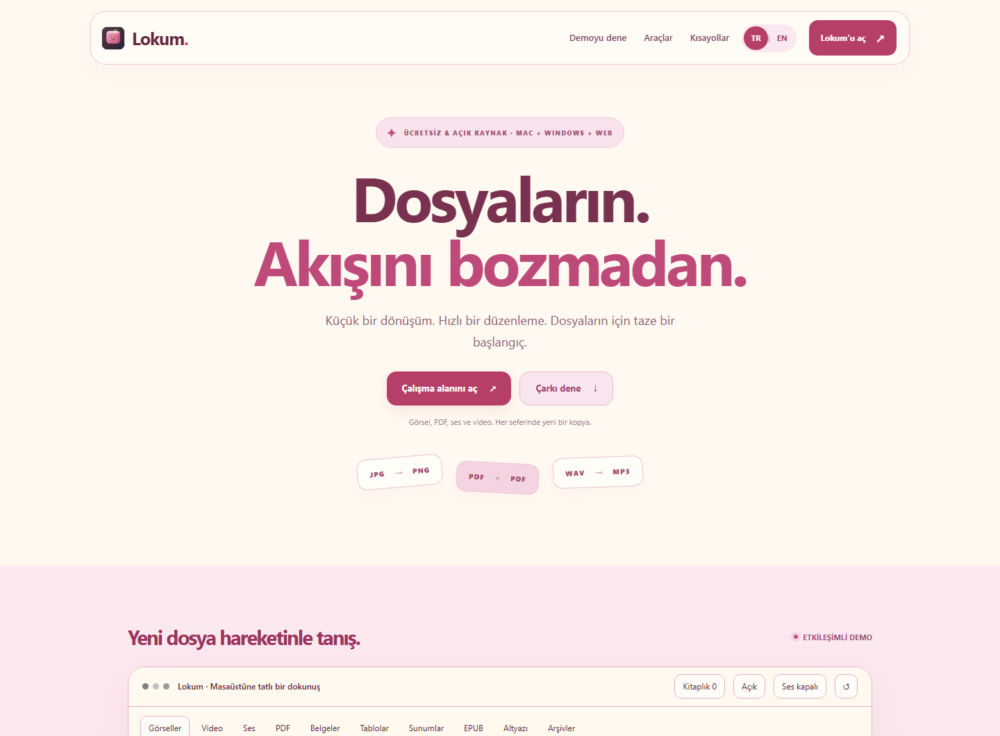
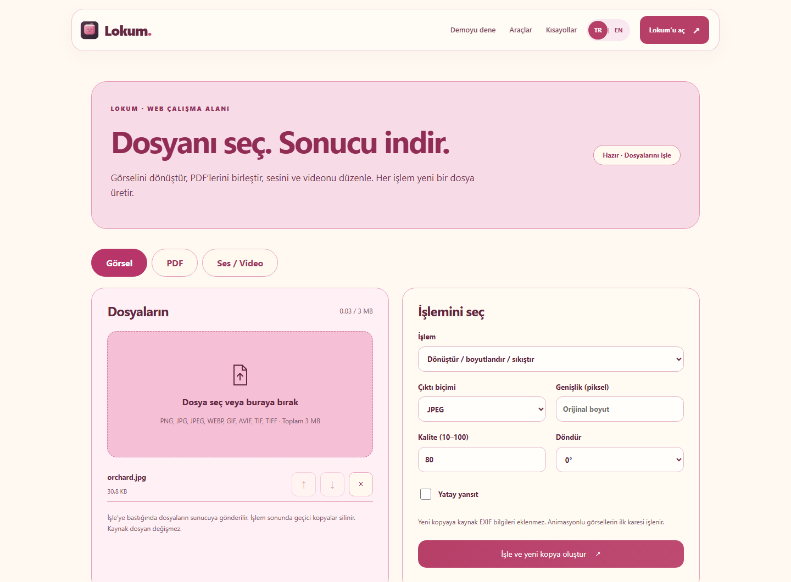
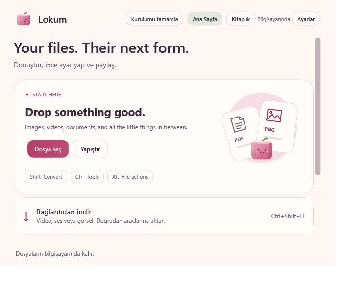
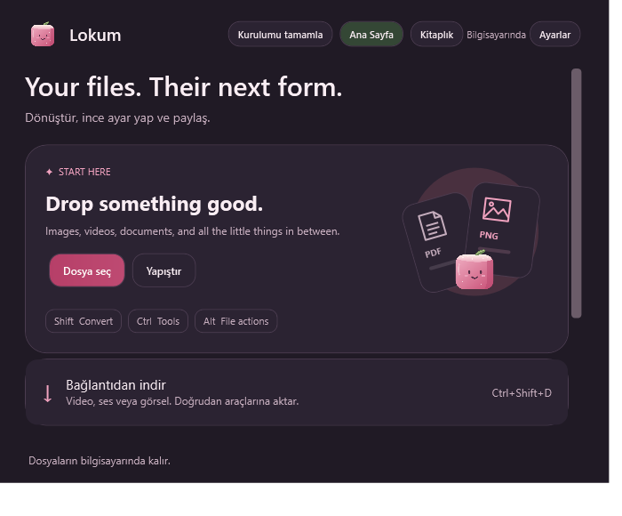

<p align="center"></p>
<h1 align="center">Lokum</h1>
<p align="center">Dosyaların için tatlı bir kolaylık.</p>
<p align="center"><a href="README.md"><strong>🇹🇷 TR</strong></a> | <a href="README.en.md">🇬🇧 EN</a></p>

Lokum; görsel, video, ses ve belge dosyaları için bir araç kutusudur. **Web sürümü yayında:** kurulum yapmadan tarayıcıda dosya işleyebilir veya daha geniş araç seti için Windows/macOS masaüstü uygulamasını kullanabilirsin. Dosyanı seç, sonucu önizle ve yeni bir kopya kaydet.

<p align="center"><a href="https://lokum-red.vercel.app/app.html"><strong>Web’de kullan ↗</strong></a> · <a href="https://lokum-red.vercel.app/tr/">Site ve etkileşimli demo</a> · <a href="https://lokum-red.vercel.app/en/app.html">English web app</a></p>

[Türkçe kullanım](README.tr.md) · [Özellik ve platform matrisi](windows/FEATURE-PARITY.md) · [Bağımlılıklar](docs/dependencies.md)

**Proje deposu:** [EnsarAslannn/Lokum](https://github.com/EnsarAslannn/Lokum) · [Hata bildir / öneri paylaş](https://github.com/EnsarAslannn/Lokum/issues)

## Web’de kullan

**[lokum-red.vercel.app](https://lokum-red.vercel.app/tr/)** üzerinde Türkçe ve İngilizce tanıtım, etkileşimli demo ve çalışan bir dosya çalışma alanı bulunur. Site ve dosya işleme API’si Vercel üzerinde yayındadır; API, Vercel Functions kullanır. Hesap veya kurulum gerekmez.

| Web çalışma alanı | Yapabileceklerin |
| --- | --- |
| Görsel | PNG/JPEG/WebP/AVIF/TIFF çıktısı, boyutlandırma, döndürme, yansıtma ve kalite ayarı |
| PDF | Birleştirme, sayfa çıkarma/sıralama/döndürme ve görsellerden PDF oluşturma |
| Ses | Dönüştürme, kesme, hız değiştirme ve ses seviyesi eşitleme |
| Video | Dönüştürme, kesme, genişlik/kalite/hız ayarı, ses kaldırma/çıkarma ve kare alma |

**İlk sürüm sınırları:** toplam 3 MB girdi, en fazla 8 dosya, 4 MB çıktı, görsel başına 24 megapiksel, PDF için 200 sayfa, medya için en fazla 120 saniyelik aralık ve 60 saniyelik işlem süresi. Büyük/uzun medya, Office dönüşümleri, otomatik altyazı/çeviri ve işletim sistemi işlemleri masaüstü uygulamasında bulunur.

Çalışma alanında **İşle** düğmesine bastığında dosyalar sunucuya gönderilir. Medya işlemlerinde kullanılan geçici klasör işlem sonunda temizlenir; sonuç açık tarayıcı sekmesinde tutulur. Tanıtım sayfasındaki etkileşimli demo ise yerelde çalışır; masaüstüne özel araçlar açıkça önizleme olarak gösterilir.

### Web görünümü

[](https://lokum-red.vercel.app/tr/)

[](https://lokum-red.vercel.app/app.html)

Görüntüler, yayındaki sitenin masaüstü tarayıcı görünümünden alınmıştır. Her iki sayfada da **TR | EN** dil seçici bulunur.

## Masaüstü görünümü

| Açık tema | Koyu tema |
| :---: | :---: |
|  |  |

| Görsel araçları | Video araçları |
| :---: | :---: |
|  |  |

Seçtiğin dosyanın türüne göre çarkın araçları değişir.

Ekranlar, Lokum Windows uygulamasının izole görsel denetiminden alınır. macOS kaynakları da yeni tema ve lokum simgesini içerir; macOS çalıştırılabilir paketi bu Windows ortamında derlenmemiştir.

## Çalıştırma

Tarayıcıda kullanmak için doğrudan **[web çalışma alanını aç](https://lokum-red.vercel.app/app.html)**. Aşağıdaki adımlar masaüstü uygulaması içindir.

Bu depo kaynak kodunu içerir; derlenmiş uygulama ve indirilen araçlar Git'e eklenmez. Hazır paket yayımlandığında [Releases](https://github.com/EnsarAslannn/Lokum/releases) sayfasından edinilebilir. Elinde `Lokum-Windows-x64.zip` varsa tamamını yazılabilir bir klasöre çıkarıp içindeki `Lokum.exe` dosyasını aç. Paketin tüm dosyalarını birlikte tut. Bağımsız Windows paketinde ayrı bir .NET kurulumu gerekmez. Kaynaktan çalıştırmak için aşağıdaki derleme adımlarını kullan.

İlk açılışta **Kurulumu tamamla → Eksik araçları indir** akışını kullan. FFmpeg/ffprobe, yt-dlp, Deno, LibreOffice ve metadata araçları ilgili işlevler için kullanılır; uygulama bunları kendi kurulum akışından, sabitlenmiş sürüm ve SHA-256 kontrolleriyle edinir. Yerel görsel ve temel PDF işlemleri hemen kullanılabilir. İndirme iptal edilirse veya başarısız olursa aynı ekrandan yeniden denenebilir.

Kütüphane ve ayarlar `%LOCALAPPDATA%/Lokum` altında saklanır.

## Masaüstü özellikleri

- **45 girdi formatı, 29 araç, 275 dönüşüm yolu:** ortak katalog ve seçim kuralları korunur.
- **Görseller:** dönüştürme, sıkıştırma, boyutlandırma, döndürme/yansıtma, kırpma, işaretleme, çerçeve, kolaj, metadata, gizleme ve QR okuma.
- **Arka plan düzenleme:** serbest veya dikdörtgen seçimle korunacak alanı belirleme, isteğe bağlı yerel otomatik kesim, şeffaf PNG, düz renk veya görsel arka plan. Tek görsel ve toplu seçim desteklenir.
- **Video ve ses:** dönüştürme, sıkıştırma, görüntü kırpma, bağımsız başlangıç/bitiş aralıklarıyla klip kesme, birleştirme, hız değiştirme, normalizasyon ve kanal ayarları. Videonun tamamını veya yalnızca seçili zaman aralığını sessize alıp sonucu önizleyebilirsin. Video sansürü, seçilen kaplama stilini gerçek işlenmiş önizlemede gösterir. [Kullanım](README.tr.md#sık-kullanılan-akışlar).
- **Otomatik altyazı:** önce videonun ana dilini seç, transkriptini oluştur ve yanlış sözcükleri veya isimleri düzelt. Ardından Türkçe veya İngilizce altyazı seç; kontrol ettiğin transkript bilgisayarında çevrilsin. Sonucu önizleyip düzenle; SRT/TXT/VTT veya altyazılı MP4 kaydet. Konuşma modeli (148 MB) ve tüm desteklenen dillerde ortak kullanılan çeviri modeli (5,7 GB) bir kez indirilir. Çeviri işlemcide çalışır; önceki küçük modellere göre daha fazla bellek ve süre ister. Ücretli API gerekmez; otomatik sonuçları kontrol etmelisin.
- **Belgeler ve arşivler:** PDF oluşturma/birleştirme/bölme/düzenleme, Office/Pages/EPUB/tablo/sunum/altyazı dönüşümleri ve arşiv işlemleri.
- **Günlük akış:** araç çarkı, sürükleme kısayolları, pano içe aktarma, Float rafı, kütüphane, klasör otomasyonu ve pencere düzenleri.
- **Web:** desteklenen herkese açık medya bağlantılarından video, ses ve görsel indirme.

İşlevlerin işletim sistemi, dosya yapısı, kurulu codec ve harici araç gereksinimleri [platform matrisinde](windows/FEATURE-PARITY.md) açıklanır. Karmaşık belge dönüşümleri kaynak belgenin bütün özelliklerini korumayabilir. Web indirme desteği ilgili sitenin davranışına bağlıdır.

## Kaynaktan derleme

Önce kaynakları al:

```sh
git clone https://github.com/EnsarAslannn/Lokum.git
cd Lokum
```

Windows için .NET 10 SDK gerekir. PowerShell'de:

```powershell
python scripts/setup-speech-engine.py
python scripts/setup-translation-runtime.py
dotnet restore windows/Lokum.Windows --locked-mode
dotnet publish windows/Lokum.Windows -c Release --no-restore -o build/windows/Lokum
.\build\windows\Lokum\Lokum.exe
```

Windows çıktısı `build/windows/Lokum` klasörüne yazılır. Tüm klasör birlikte dağıtılmalıdır.

macOS için macOS 13.3+, Apple Silicon ve Xcode/Swift 6 gerekir:

```sh
scripts/setup-exiftool.sh
swift build --product Lokum
swift test
scripts/build-app.sh release
```

macOS çıktısı `build/Lokum.app` konumuna yazılır. macOS kaynaklarının derleme ve çalışma doğrulaması bir Mac üzerinde yapılmalıdır.

## Geliştirme ve doğrulama

```powershell
dotnet run --project windows/Lokum.Verify -c Release
dotnet run --project windows/Lokum.Verify -c Release -- --background-removal-only
dotnet run --project windows/Lokum.Verify -c Release -- --background-editing-only
dotnet run --project windows/Lokum.Verify -c Release -- --image-workspace-only
python scripts/check-feature-parity.py
python scripts/generate-localizations.py --check
```

Windows arayüzünü kullanıcı kütüphanesine dokunmadan denetlemek için, derledikten sonra:

```powershell
.\build\windows\Lokum\Lokum.exe --ui-audit build/ui-audit
```

Bu denetim açık/koyu tema ve Türkçe/İngilizce sahnelerini, ana ekran ile kütüphanedeki düğmelerin tıklama hedeflerini kontrol eder. Gerçek fare, klavye ve dışa aktarma testlerinin tamamının yerini tutmaz. Ayrıntılar: [arayüz denetimi](docs/testing/UI-AUDIT.md) ve [katkı rehberi](CONTRIBUTING.md).

Derleme çıktıları (`build`, `bin`, `obj`), indirilen araçlar, yerel ayarlar ve gizli anahtarlar `.gitignore` ile dışarıda tutulur. Kendi erişim anahtarlarını veya kişisel test dosyalarını depoya ekleme.

## Kısayollar

| Windows | İşlem |
| --- | --- |
| Ctrl+O | Dosya seç |
| Ctrl+V | Dosya, metin, görsel veya bağlantı yapıştır |
| Ctrl+Space | Seçili dosyaların araç çarkını aç |
| Ctrl+1 / Ctrl+2 | Ana ekran / kütüphane |
| Ctrl+F | Kütüphanede ara |
| Ctrl+Shift+D | Kopyalanmış indirme bağlantısını aç |
| Space / ← / → / I / O | Desteklenen medya editörlerinde oynatma, gezinme ve aralık işaretleri |
| Shift+sürükleme / Enter | Kırpma oranını kilitle / kırpılmış kopyayı kaydet |

macOS'ta Finder sürüklemesi sırasında Shift dönüştürme, Command araçlar ve Control dosya işlemleri çarkını açar. Sürükleme tuşları ayarlardan değiştirilebilir. Metin alanlarında normal yapıştırma ve gezinme korunur.

## Gizlilik ve güncellemeler

Masaüstü uygulamasındaki dönüştürme ve düzenleme yerelde çalışır. Medya bağlantısı indirme seçilen siteye, eksik araçların kurulumu ilgili resmi dağıtım kaynağına bağlanır. Web çalışma alanındaki dosyalar ise yalnızca **İşle** düğmesine basıldığında sunucuya gönderilir. Analytics, bulut hesabı veya tarayıcı çerezi içe aktarma bulunmaz.

Lokum imzalı güncellemeleri destekler. Bir yayın deposu ve güvenilir imza anahtarı yapılandırılana kadar otomatik güncelleme kanalı bağlı değildir. [Kanal yapılandırma notları](docs/LOKUM.md) yayınlayan kişi içindir.

## Lisans

[MIT lisansı](LICENSE). Proje sorumlusu: [EnsarAslannn](https://github.com/EnsarAslannn).

Harici araç ve kütüphanelerin kendi lisansları geçerlidir: [macOS bildirimleri](Resources/THIRD-PARTY-NOTICES.txt), [Windows bildirimleri](windows/THIRD-PARTY-NOTICES.txt).
